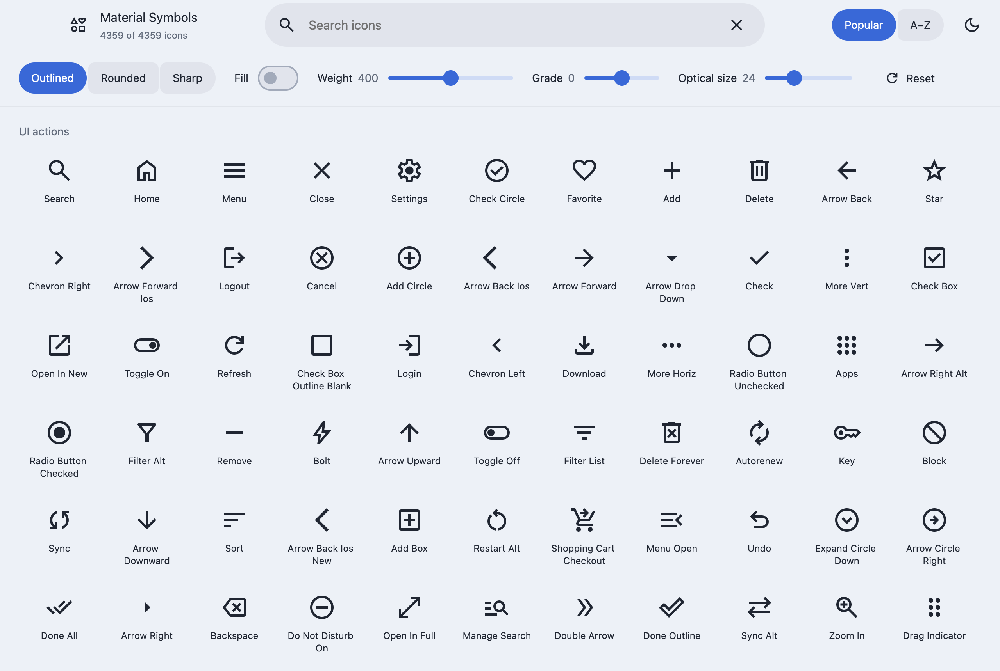
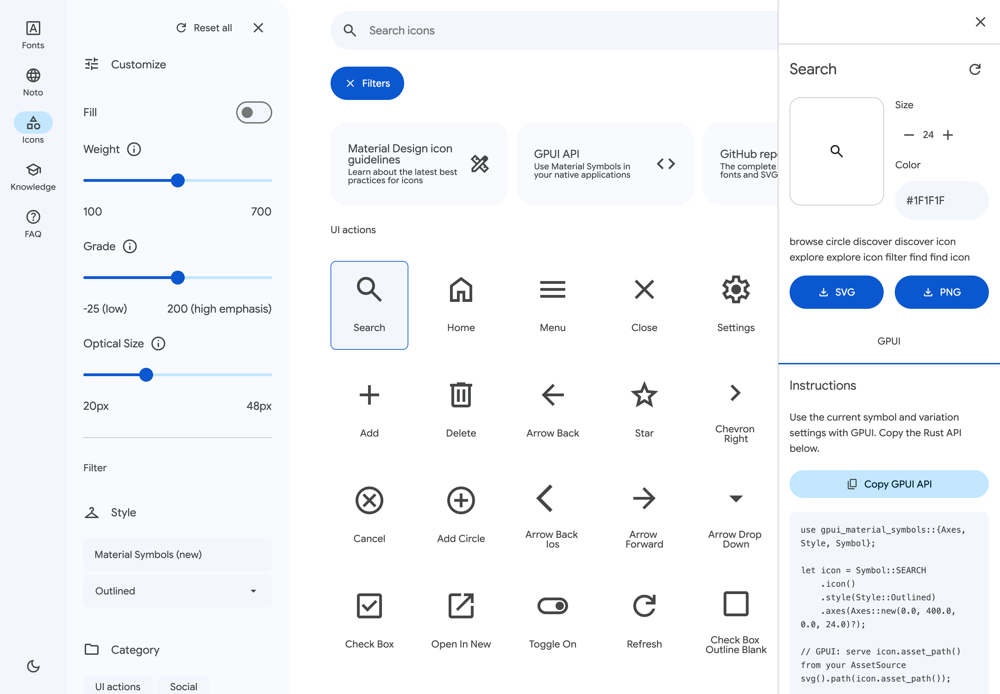
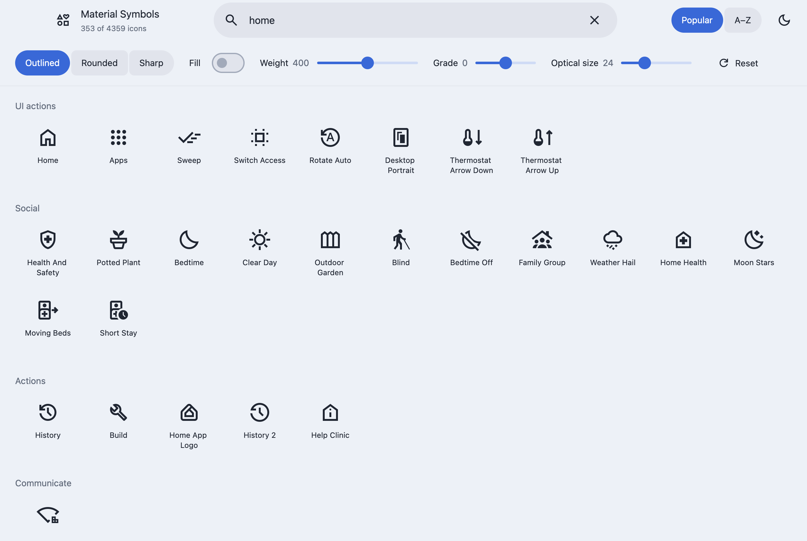
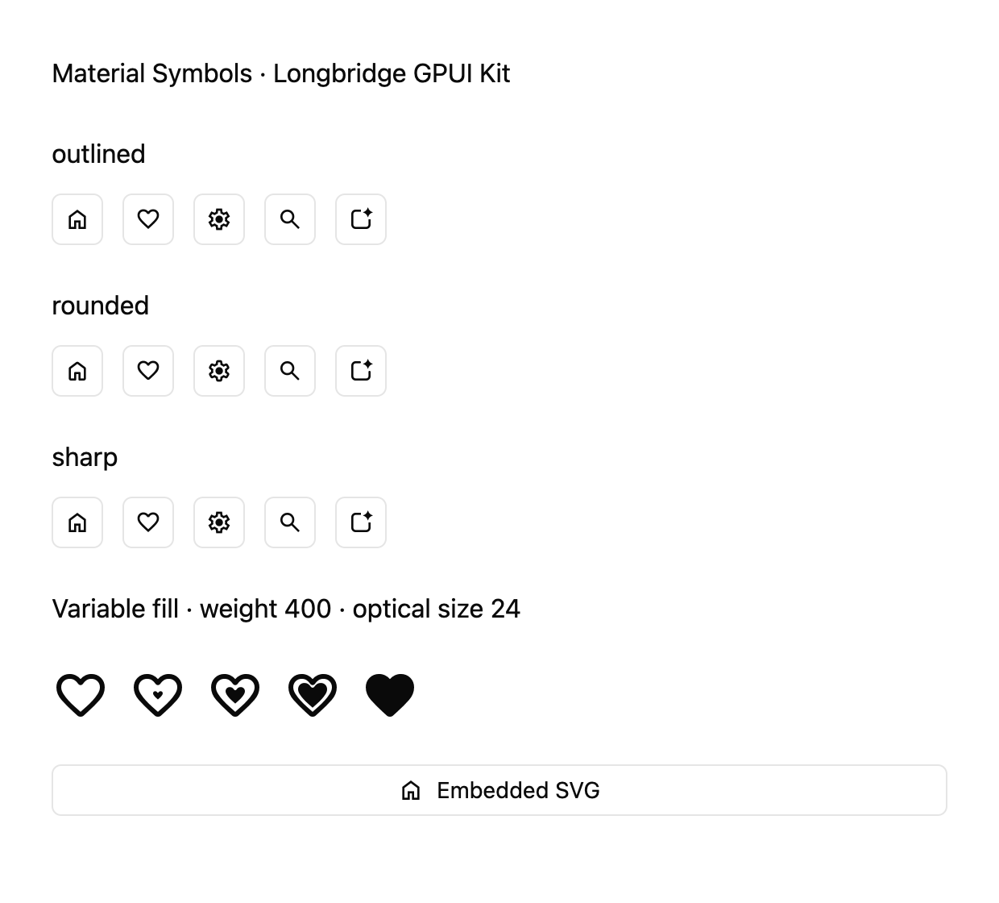

# gpui-material-symbols

**English** | [简体中文](README.zh-CN.md)

Every Google Material Symbol, ready to use in
[Longbridge GPUI Kit](https://github.com/longbridge/gpui-kit) applications:
4,359 icon names in the Outlined, Rounded and Sharp styles, with continuously
adjustable fill, weight, grade and optical size. `Symbol` implements Kit's
`IconNamed`, so icons drop straight into buttons, menus and every other
standard icon slot.

**Try the icon browser in your browser: <https://m3symbols.mizore.blog>**
(WebAssembly, about 8 MB on the first visit).

## Run the examples

```sh
git clone https://github.com/mizorewww/gpui-kit-material
git clone https://github.com/mizorewww/gpui-material-symbols
cd gpui-material-symbols

# Icon browser for the whole catalog (built with gpui-kit-material)
cargo run -p gpui-material-symbols-browser --bin material_symbols

# Material Symbols in Longbridge GPUI Kit components
cargo run --features showcase --example showcase

# Export one SVG from the command line
cargo run --no-default-features --features embed-assets --example export -- home rounded > home.svg
```

Workspace patches use the adjacent `../gpui-kit-material` checkout to share its
audited Kit/GPUI compatibility fixes. Keep both repositories updated together.

The browser also builds for the web; see the [web preview guide](docs/web.md).

## Screenshots

The native browser is the independent `gpui-material-symbols-browser` workspace
package. Its default `material-browser` feature embeds the assets. The former
root command `--features material-browser --example material_symbols` is replaced
by `-p gpui-material-symbols-browser --bin material_symbols`; the root library no
longer depends on Material, which can now consume Symbols without a reverse edge.
The `showcase` and `export` examples keep their existing entry points.

### Icon browser (`material_symbols`)

Search all 4,359 icons, switch style, adjust fill, weight, grade and optical
size, export SVG or PNG, and copy the matching Rust code. The theme follows the
system's light or dark appearance until you pick one.

<picture>
  <source media="(prefers-color-scheme: dark)" srcset="docs/screenshots/material-symbols-dark.png">
  
</picture>

The details panel, with export and the generated Rust code:

<picture>
  <source media="(prefers-color-scheme: dark)" srcset="docs/screenshots/material-symbols-detail-dark.png">
  
</picture>

Searching for "home":



### Kit integration (`showcase`)

All three styles in Kit `Button`s, the continuous fill axis, and an embedded
SVG icon.



## Features

- **Complete:** the full union of Google's variable-font names and SVG-only
  names, pinned to an exact upstream commit with recorded checksums.
- **Offline:** with the default `embed-assets` feature, the official fonts and
  SVGs are embedded; builds and apps never download anything or register
  system fonts.
- **Validated:** out-of-range axes and unsupported variants are errors, never
  silently substituted icons.

| Axis | Range |
| --- | --- |
| FILL | `0..=1` |
| wght (weight) | `100..=700` |
| GRAD (grade) | `-50..=200` |
| opsz (optical size) | `20..=48` |

## Installation

```toml
[dependencies]
gpui-material-symbols = { git = "https://github.com/mizorewww/gpui-material-symbols" }
```

The crate tracks the `main` branch of `longbridge/gpui-kit` and re-exports that
exact Kit as `gpui_material_symbols::kit`. Using the re-export keeps the types
consistent; you do not need to declare GPUI yourself.

## Usage

### Register the assets

Combine Material Symbols with Kit's own assets at startup:

```rust,no_run
use gpui_material_symbols::{kit, MaterialSymbols};

kit::application()
    .with_assets(MaterialSymbols.with_fallback(kit::assets::Assets))
    .run(|cx| {
        kit::init(cx);
        // kit::open_window(...)
    });
```

### Use icons in Kit components

A `Symbol` or a configured `Icon` works anywhere Kit accepts an icon:

```rust
use gpui_material_symbols::{kit, Style, Symbol};
use kit::component::{button::Button, menu::PopupMenuItem};

let home = Button::new("home").icon(Symbol::HOME);
let favorite = Button::new("favorite")
    .icon(Symbol::FAVORITE.icon().style(Style::Rounded).filled(true));
let settings = PopupMenuItem::new("Settings").icon(Symbol::SETTINGS);
```

### Styles and variable axes

```rust
use gpui_material_symbols::{kit, Axes, Style, Symbol};

let icon = Symbol::HOME
    .icon()
    .style(Style::Sharp)
    .axes(Axes::new(0.5, 550.0, 25.0, 32.0).unwrap()); // fill, weight, grade, optical size

let themed: kit::component::Icon = icon.component();          // loaded through the registered assets
let embedded: kit::component::Icon = icon.embedded().unwrap(); // SVG inlined; no asset registration
```

`Axes::new` rejects out-of-range and non-finite values. Optical size only
changes the glyph's design; the rendered size is still set with Kit's
`.size()` and related methods.

### Look up symbols by name

```rust
use gpui_material_symbols::Symbol;

let home: Symbol = "home".parse().unwrap();
assert_eq!(home, Symbol::HOME);
assert!(Symbol::named("does_not_exist").is_none());

let arrows = Symbol::all().filter(|s| s.name().contains("arrow")).count();
assert!(arrows > 0);
```

Constants are the upper-case official names. Names that start with a digit get
a leading underscore, for example `Symbol::_10K`.

### SVG-only symbols

> [!NOTE]
> 55 symbols, such as `Symbol::APP_SPARK`, have official SVGs but no
> variable-font glyph. They support only Google's discrete values: fill 0 or 1,
> weight 100–700 in steps of 100, grade -25, 0 or 200, and optical size 20, 24,
> 40 or 48.

Unsupported combinations are never replaced with a nearby variant:

```rust
use gpui_material_symbols::{Axes, Error, Symbol};

let spark = Symbol::APP_SPARK;
assert!(!spark.is_variable());
assert!(spark.available_variants().all(|icon| icon.is_supported()));

let odd = spark.icon().axes(Axes::new(0.0, 450.0, 0.0, 24.0).unwrap());
assert!(!odd.is_supported());
assert_eq!(odd.to_svg(), Err(Error::UnsupportedVariant));
```

`.component()` loads icons by path, so such a combination renders empty. Use
`.embedded()` to get the error when the icon is built.

### SVG export without Kit

```toml
[dependencies]
gpui-material-symbols = { git = "https://github.com/mizorewww/gpui-material-symbols", default-features = false, features = ["embed-assets"] }
```

```rust
use gpui_material_symbols::{Style, Symbol};

let svg = Symbol::HOME.icon().style(Style::Rounded).to_svg().unwrap();
assert!(svg.starts_with("<svg"));
```

### Load the fonts at runtime

The default `embed-assets` feature builds about 50 MB of fonts and SVGs into
the binary. Leave it out, for example on the web, and supply each `Asset`
when you have its file; until then `to_svg` returns `Error::NotLoaded`:

```rust,ignore
use gpui_material_symbols::{Asset, Style};

let font = Asset::Font(Style::Outlined);
font.provide(downloaded_bytes)?; // exactly assets/MaterialSymbolsOutlined.ttf
assert!(font.is_available());
```

`Icon::required_asset` names the file an icon needs. The
[web preview](docs/web.md) downloads only the styles it shows this way.

## Help and contributing

Report bugs and ask questions in
[GitHub Issues](https://github.com/mizorewww/gpui-material-symbols/issues).
The project is maintained by [@mizorewww](https://github.com/mizorewww).
Before sending changes, read the [maintenance guide](docs/maintenance.md),
which covers the validation commands, updating Kit and the Google assets, and
regenerating the screenshots.

More background: [validation record](docs/validation.md) ·
[research notes](docs/research.md) · [icon browser](docs/MATERIAL_SYMBOLS.md) ·
[web preview](docs/web.md).
The icon data is pinned to `google/material-design-icons` commit `10ecc14`;
sources and checksums are in [`assets/manifest.json`](assets/manifest.json).

## License

Apache-2.0, see [LICENSE](LICENSE). Google's icon assets are also Apache-2.0
([`assets/LICENSE`](assets/LICENSE)); third-party assets used by the examples
are listed in [NOTICE](NOTICE). This project is not affiliated with or
endorsed by Google.
