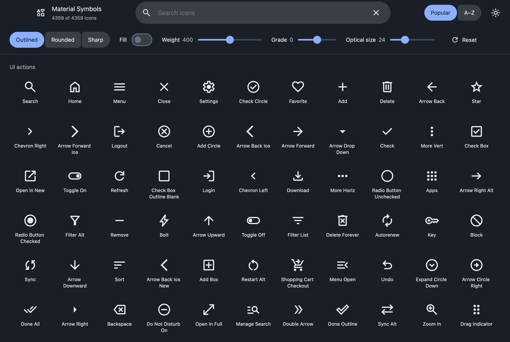

# gpui-material-symbols

在 [Longbridge GPUI Kit](https://github.com/longbridge/gpui-kit) 应用中直接使用全部 Google
Material Symbols：4,359 个图标名称，Outlined / Rounded / Sharp 三种风格，以及连续可调的
填充、粗细、等级和光学尺寸。`Symbol` 实现了 Kit 的 `IconNamed`，可以直接放进按钮、菜单等
任意标准图标槽位。官方字体和 SVG 全部内嵌在库中，构建和运行时不联网、不注册系统字体。

| 轴 | 取值 |
| --- | --- |
| FILL 填充 | `0..=1` |
| wght 粗细 | `100..=700` |
| GRAD 等级 | `-50..=200` |
| opsz 光学尺寸 | `20..=48` |

## 示例截图

`showcase` 示例：Kit `Button` 中的三种风格，以及连续变化的填充轴。


`material_symbols` 示例：仿 Google Fonts Icons 的原生 GPUI 图标浏览器，可搜索全部图标、调节四个轴、
复制 Rust 代码并导出 SVG/PNG。

| 浅色 | 深色 |
| --- | --- |
|  |  |
| **图标详情** | **搜索** |
|  |  |

## 安装

本库通过 Git 分发（仓库目前为私有，需要有读取权限的凭据）：

```toml
[dependencies]
gpui-material-symbols = { git = "https://github.com/mizorewww/gpui-material-symbols" }
```

本库跟随 `longbridge/gpui-kit` 的 `main` 分支，并以 `gpui_material_symbols::kit` 重新导出同一个 Kit。
使用这个导出可以保证类型一致，应用无需单独声明 GPUI。

## 使用

### 注册资源

启动时把 Material Symbols 与 Kit 自带资源组合起来：

```rust,no_run
use gpui_material_symbols::{kit, MaterialSymbols};

kit::application()
    .with_assets(MaterialSymbols.with_fallback(kit::assets::Assets))
    .run(|cx| {
        kit::init(cx);
        // kit::open_window(...)
    });
```

### 放进 Kit 组件

`Symbol` 和配置后的 `Icon` 都可以用在任何接受图标的地方：

```rust
use gpui_material_symbols::{kit, Style, Symbol};
use kit::component::{button::Button, menu::PopupMenuItem};

let home = Button::new("home").icon(Symbol::HOME);
let favorite = Button::new("favorite")
    .icon(Symbol::FAVORITE.icon().style(Style::Rounded).filled(true));
let settings = PopupMenuItem::new("Settings").icon(Symbol::SETTINGS);
```

### 风格与可变轴

```rust
use gpui_material_symbols::{kit, Axes, Style, Symbol};

let icon = Symbol::HOME
    .icon()
    .style(Style::Sharp)
    .axes(Axes::new(0.5, 550.0, 25.0, 32.0).unwrap()); // fill, weight, grade, optical size

let themed: kit::component::Icon = icon.component();          // 经由已注册的资源加载
let embedded: kit::component::Icon = icon.embedded().unwrap(); // SVG 直接内嵌，无需注册资源
```

`Axes::new` 会拒绝越界值和非有限值。光学尺寸只影响图标造型，与显示尺寸无关，
显示尺寸仍由 Kit 的 `.size()` 等方法控制。

### 按名称查找

```rust
use gpui_material_symbols::Symbol;

let home: Symbol = "home".parse().unwrap();
assert_eq!(home, Symbol::HOME);
assert!(Symbol::named("does_not_exist").is_none());

let arrows = Symbol::all().filter(|s| s.name().contains("arrow")).count();
assert!(arrows > 0);
```

常量名是官方名称的大写形式；以数字开头的名称加前导下划线，例如 `Symbol::_10K`。

### 仅有 SVG 的图标

有 55 个图标（例如 `Symbol::APP_SPARK`）只有官方 SVG，没有可变字体字形，因此只支持官方离散取值：
填充 0/1，粗细 100–700 中的整百值，等级 -25/0/200，光学尺寸 20/24/40/48。
不支持的组合不会被悄悄换成近似值：

```rust
use gpui_material_symbols::{Axes, Error, Symbol};

let spark = Symbol::APP_SPARK;
assert!(!spark.is_variable());
assert!(spark.available_variants().all(|icon| icon.is_supported()));

let odd = spark.icon().axes(Axes::new(0.0, 450.0, 0.0, 24.0).unwrap());
assert!(!odd.is_supported());
assert_eq!(odd.to_svg(), Err(Error::UnsupportedVariant));
```

`.component()` 按路径加载，遇到这类组合时只会显示为空白；用 `.embedded()` 可以在构造时就拿到错误。

### 不依赖 Kit，只导出 SVG

```toml
[dependencies]
gpui-material-symbols = { git = "https://github.com/mizorewww/gpui-material-symbols", default-features = false }
```

```rust
use gpui_material_symbols::{Style, Symbol};

let svg = Symbol::HOME.icon().style(Style::Rounded).to_svg().unwrap();
assert!(svg.starts_with("<svg"));
```

## 运行示例

```sh
# Kit 集成示例
cargo run --features showcase --example showcase

# 图标浏览器（使用 gpui-kit-material 组件）
cargo run --no-default-features --features material-browser --example material_symbols

# 命令行导出 SVG
cargo run --no-default-features --example export -- home rounded > home.svg
```

## 更多

- [维护指南](docs/maintenance.md)：验证命令、更新 Kit 与 Google 资源、重新生成截图
- [验证记录](docs/validation.md) · [调研记录](docs/research.md) · [图标浏览器说明](docs/MATERIAL_SYMBOLS.md)
- 图标数据固定在 `google/material-design-icons` 提交 `10ecc14`，来源与校验值见 `assets/manifest.json`

本项目以 Apache-2.0 许可发布。Google 的图标资源同为 Apache-2.0（`assets/LICENSE`）；
示例中的第三方资源见 [NOTICE](NOTICE)。
