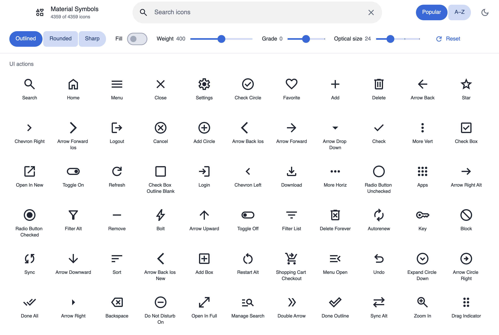
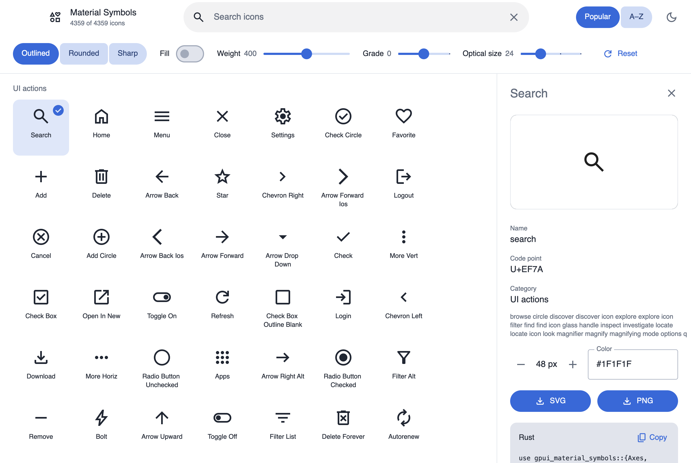
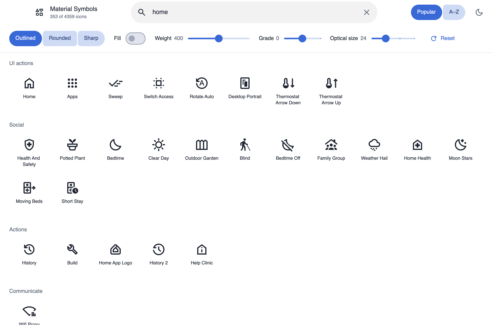
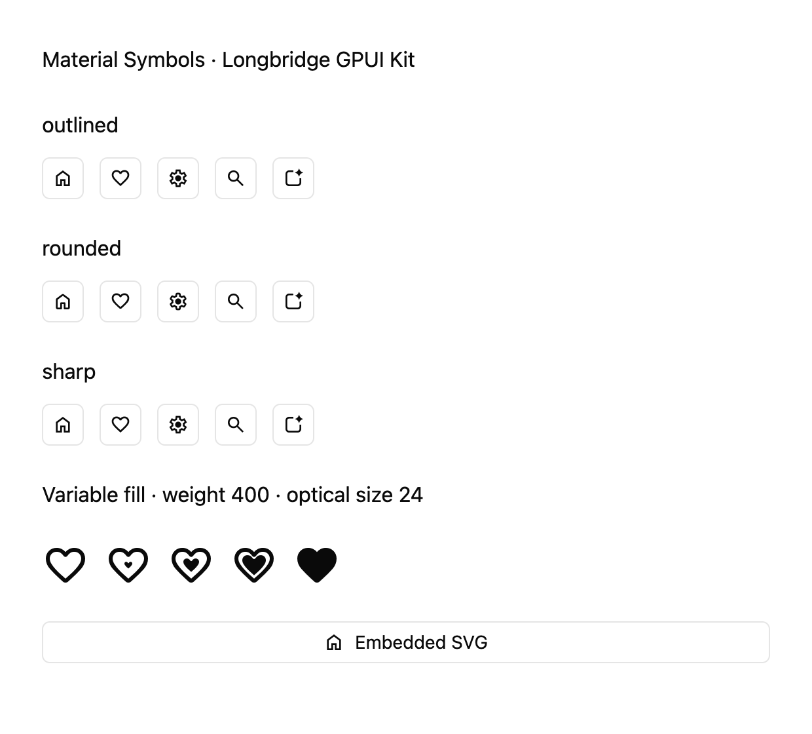

# gpui-material-symbols

[English](README.md) | **简体中文**

在 [Longbridge GPUI Kit](https://github.com/longbridge/gpui-kit) 应用中直接使用全部 Google
Material Symbols：4,359 个图标名称，Outlined / Rounded / Sharp 三种风格，以及连续可调的
填充、粗细、等级和光学尺寸。`Symbol` 实现了 Kit 的 `IconNamed`，可以直接放进按钮、菜单等
任意标准图标槽位。

**在浏览器中直接试用图标浏览器：<https://m3symbols.mizore.blog>**（WebAssembly，首次访问约下载 8 MB）。

## 运行示例

```sh
git clone https://github.com/mizorewww/gpui-material-symbols
cd gpui-material-symbols

# 全部图标的浏览器（基于 gpui-kit-material）
cargo run -p gpui-material-symbols-browser --bin material_symbols

# 在 Longbridge GPUI Kit 组件中使用 Material Symbols
cargo run --features showcase --example showcase

# 命令行导出单个 SVG
cargo run --no-default-features --features embed-assets --example export -- home rounded > home.svg
```

库本身直接基于 crates.io 上的 `gpui-kit` 0.9 构建，不需要任何 patch。浏览器和网页版使用 crates.io
上的 `gpui-kit-material` 0.1 和 `gpui-kit` 0.9.1。workspace 只把 Symbols patch 到本仓库，并把 `gpui-kit`
patch 到 gpui-kit-material 在固定修订中 vendored 的同一 0.9.1 源码：其 manifest 让 WebAssembly 保持单线程，
而发布版 Kit 以多线程构建 Web 平台，需要 nightly 工具链。

图标浏览器也可以构建为网页版，见 [网页预览说明](docs/web.md)。

## 截图

原生浏览器属于独立的 workspace package `gpui-material-symbols-browser`，
默认启用该 package 的 `material-browser` feature 并嵌入图标资源。
原根包命令 `--features material-browser --example material_symbols` 已替换为
`-p gpui-material-symbols-browser --bin material_symbols`。根 symbols 库不再反向
依赖 Material，因此 Material 可以使用 Symbols 而不形成依赖环。
`showcase` 和 `export` 示例的入口保持不变。

### 图标浏览器（`material_symbols`）

搜索全部 4,359 个图标，切换风格，调节填充、粗细、等级和光学尺寸，导出 SVG/PNG，并复制对应的 Rust 代码。
主题默认跟随系统的浅色或深色模式，也可以手动切换。

<picture>
  <source media="(prefers-color-scheme: dark)" srcset="docs/screenshots/material-symbols-dark.png">
  
</picture>

详情面板，包含导出和生成的 Rust 代码：

<picture>
  <source media="(prefers-color-scheme: dark)" srcset="docs/screenshots/material-symbols-detail-dark.png">
  
</picture>

搜索 “home”：



### Kit 集成（`showcase`）

Kit `Button` 中的三种风格、连续变化的填充轴，以及内嵌 SVG 图标。



## 特性

- **完整**：Google 可变字体名称与仅有 SVG 的名称的并集，固定到确切的上游提交并记录校验值。
- **离线**：默认的 `embed-assets` feature 内嵌全部官方字体和 SVG，运行时不联网、不注册系统字体。
- **严格校验**：越界的轴值和不支持的变体会返回错误，绝不悄悄换成近似图标。

| 轴 | 取值 |
| --- | --- |
| FILL 填充 | `0..=1` |
| wght 粗细 | `100..=700` |
| GRAD 等级 | `-50..=200` |
| opsz 光学尺寸 | `20..=48` |

## 安装

```toml
[dependencies]
gpui-material-symbols = "0.1"
```

本库支持 crates.io 上的 [`gpui-kit`](https://crates.io/crates/gpui-kit) 0.9，并以
`gpui_material_symbols::kit` 重新导出同一个 Kit。使用这个导出可以保证类型一致，应用无需单独声明 GPUI。
如果应用对 `gpui-kit` 打了 patch（例如改用 Kit 的 Git `main`），请同时 patch crates.io 来源，
让两者解析为同一个 Kit。

### Features

| Feature | 默认 | 作用 |
| --- | --- | --- |
| `gpui-kit` | 是 | `MaterialSymbols` 资源源、`IconNamed`、`Icon::component` / `embedded` / `svg` |
| `embed-assets` | 是 | 启用 `outlined`、`rounded`、`sharp` 和 `supplemental` |
| `outlined` | 随 `embed-assets` | 内嵌 Outlined 字体（10.7 MB） |
| `rounded` | 随 `embed-assets` | 内嵌 Rounded 字体（15.2 MB） |
| `sharp` | 随 `embed-assets` | 内嵌 Sharp 字体（8.9 MB） |
| `supplemental` | 随 `embed-assets` | 内嵌 55 个仅有 SVG 的图标（16.1 MB） |
| `gpui-fast` | 否 | 选用 Kit 的 `gpui-fast` 引擎 |

字体和 SVG 包超出 crates.io 单个包的大小上限，因此各自放在无依赖的数据 crate 中：
[`gpui-material-symbols-outlined`](https://crates.io/crates/gpui-material-symbols-outlined)、
[`-rounded`](https://crates.io/crates/gpui-material-symbols-rounded)、
[`-sharp`](https://crates.io/crates/gpui-material-symbols-sharp) 和
[`-supplemental`](https://crates.io/crates/gpui-material-symbols-supplemental)。
它们由上面的 feature 引入，无需直接依赖。目录始终包含全部风格和全部图标：对应 feature 未启用的资源会返回
`Error::NotLoaded`，直到运行时提供（见下文）。

例如只内嵌 Outlined 风格：

```toml
[dependencies]
gpui-material-symbols = { version = "0.1", default-features = false, features = ["gpui-kit", "outlined"] }
```

## 使用

### 注册资源

启动时把 Material Symbols 与 Kit 自带资源组合起来：

```rust,no_run
use gpui_material_symbols::{kit, MaterialSymbols};

kit::application()
    .with_assets(MaterialSymbols.with_fallback(kit::assets::Assets))
    .run(|cx| {
        kit::init(cx);
        // kit::open_window(...)
    });
```

### 放进 Kit 组件

`Symbol` 和配置后的 `Icon` 都可以用在任何接受图标的地方：

```rust
use gpui_material_symbols::{kit, Style, Symbol};
use kit::component::{button::Button, menu::PopupMenuItem};

let home = Button::new("home").icon(Symbol::HOME);
let favorite = Button::new("favorite")
    .icon(Symbol::FAVORITE.icon().style(Style::Rounded).filled(true));
let settings = PopupMenuItem::new("Settings").icon(Symbol::SETTINGS);
```

### 风格与可变轴

```rust
use gpui_material_symbols::{kit, Axes, Style, Symbol};

let icon = Symbol::HOME
    .icon()
    .style(Style::Sharp)
    .axes(Axes::new(0.5, 550.0, 25.0, 32.0).unwrap()); // fill, weight, grade, optical size

let themed: kit::component::Icon = icon.component();          // 经由已注册的资源加载
let embedded: kit::component::Icon = icon.embedded().unwrap(); // SVG 直接内嵌，无需注册资源
```

`Axes::new` 会拒绝越界值和非有限值。光学尺寸只影响图标造型，与显示尺寸无关，
显示尺寸仍由 Kit 的 `.size()` 等方法控制。

### 按名称查找

```rust
use gpui_material_symbols::Symbol;

let home: Symbol = "home".parse().unwrap();
assert_eq!(home, Symbol::HOME);
assert!(Symbol::named("does_not_exist").is_none());

let arrows = Symbol::all().filter(|s| s.name().contains("arrow")).count();
assert!(arrows > 0);
```

常量名是官方名称的大写形式；以数字开头的名称加前导下划线，例如 `Symbol::_10K`。

### 仅有 SVG 的图标

> [!NOTE]
> 有 55 个图标（例如 `Symbol::APP_SPARK`）只有官方 SVG，没有可变字体字形，因此只支持官方离散取值：
> 填充 0/1，粗细 100–700 中的整百值，等级 -25/0/200，光学尺寸 20/24/40/48。

不支持的组合不会被悄悄换成近似值：

```rust
use gpui_material_symbols::{Axes, Error, Symbol};

let spark = Symbol::APP_SPARK;
assert!(!spark.is_variable());
assert!(spark.available_variants().all(|icon| icon.is_supported()));

let odd = spark.icon().axes(Axes::new(0.0, 450.0, 0.0, 24.0).unwrap());
assert!(!odd.is_supported());
assert_eq!(odd.to_svg(), Err(Error::UnsupportedVariant));
```

`.component()` 按路径加载，遇到这类组合时只会显示为空白；用 `.embedded()` 可以在构造时就拿到错误。

### 不依赖 Kit，只导出 SVG

```toml
[dependencies]
gpui-material-symbols = { version = "0.1", default-features = false, features = ["embed-assets"] }
```

```rust
use gpui_material_symbols::{Style, Symbol};

let svg = Symbol::HOME.icon().style(Style::Rounded).to_svg().unwrap();
assert!(svg.starts_with("<svg"));
```

### 运行时加载字体

默认的 `embed-assets` feature 会把约 51 MB 的字体和 SVG 编进二进制。不启用它、或只启用部分资源
feature（例如网页版）时，拿到文件后用 `Asset::provide` 逐个提供缺少的资源；在此之前 `to_svg` 返回
`Error::NotLoaded`：

```rust,ignore
use gpui_material_symbols::{Asset, Style};

let font = Asset::Font(Style::Rounded);
assert!(!font.is_embedded()); // 未启用 `rounded` feature
font.provide(downloaded_bytes)?; // 必须与 Google 的 MaterialSymbolsRounded.ttf 完全一致
assert!(font.is_available());
```

`Icon::required_asset` 给出某个图标需要的文件，`Asset::file_name` 和 `Asset::size` 标识该文件，
`Asset::feature` 给出能内嵌它的 feature。[网页预览](docs/web.md)就是这样只下载当前显示的风格。

## 帮助与贡献

问题反馈和使用疑问请提交到 [GitHub Issues](https://github.com/mizorewww/gpui-material-symbols/issues)。
项目由 [@mizorewww](https://github.com/mizorewww) 维护。提交改动前请阅读[维护指南](docs/maintenance.md)，
其中包括验证命令、更新 Kit 与 Google 资源以及重新生成截图的方法。

更多背景：[验证记录](docs/validation.md) · [调研记录](docs/research.md) · [图标浏览器说明](docs/MATERIAL_SYMBOLS.md) · [网页预览](docs/web.md)。
图标数据固定在 `google/material-design-icons` 提交 `10ecc14`，来源、大小与校验值见 [`assets/manifest.json`](assets/manifest.json)。版本说明见[更新日志](CHANGELOG.md)。

## 许可

Apache-2.0，见 [LICENSE](LICENSE)。Google 的图标资源同为 Apache-2.0（[`assets/LICENSE`](assets/LICENSE)）；
示例使用的第三方资源见 [NOTICE](NOTICE)。本项目与 Google 无关联，也未获其背书。
