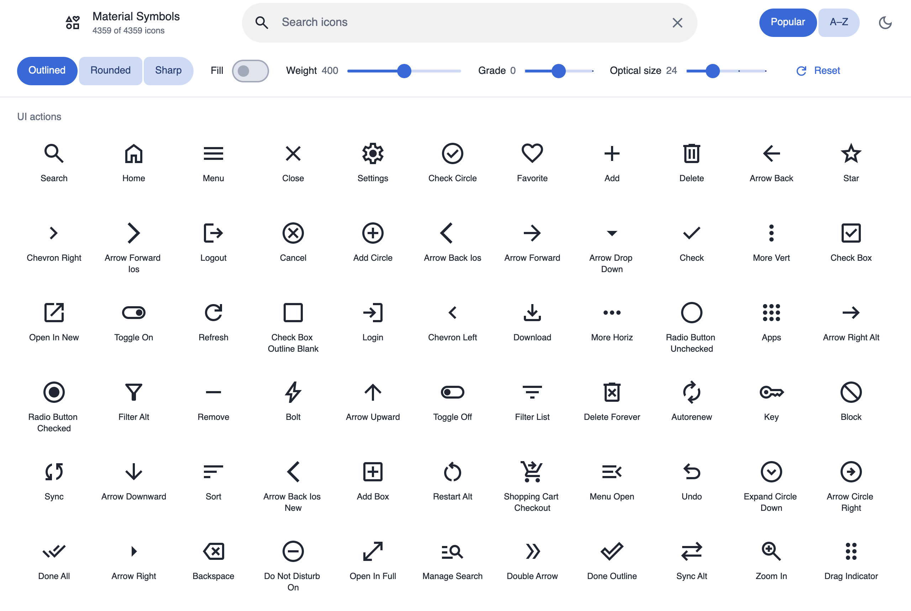

# Material Symbols browser

A native GPUI icon browser for this crate's complete catalog, built with
components from [`gpui-kit-material`](https://github.com/mizorewww/gpui-kit-material)
on the same `gpui-pre` backend as Longbridge GPUI Kit. No WebView is used.

The native executable lives in the independent `gpui-material-symbols-browser`
workspace package (`browser/`). Its default `material-browser` feature embeds
assets; it is no longer a feature or example target of the root symbols library.
This keeps the consumer → Material → symbols dependency direction acyclic.

```sh
cargo run -p gpui-material-symbols-browser --bin material_symbols
```



[Dark theme](screenshots/material-symbols-dark.png) · [Details](screenshots/material-symbols-detail.png) · [Details, dark](screenshots/material-symbols-detail-dark.png) · [Search](screenshots/material-symbols-search.png)

## Features

- All 4,359 names in a virtualized grid grouped by category, including names
  that Google Fonts' public metadata does not list (under Other).
- Search by name or tag, sorted by popularity or name.
- Outlined, Rounded and Sharp, with fill, weight, grade and optical size.
- A details panel beside the grid with name, code point, category and tags;
  SVG and PNG export at a chosen size and color, previewed on a white canvas;
  and copyable Rust that reproduces the selection.
- Light and dark themes that follow the system appearance until you choose
  one with the theme button.
- The app bar is the window's title bar, drawn in the app's own colors: macOS
  keeps its traffic lights inside it, Windows and Linux get the kit's caption
  buttons, and dragging or double-clicking it moves or zooms the window.

SVG-only names show an unavailable state for axis combinations Google does not
publish; the browser never substitutes a different variant.

## Components

Every control comes from `gpui-kit-material`, started through Kit's
`application`, `init` and `open_window` with Material's Component theme bridge:

| Part | Component |
| --- | --- |
| App bar | `TitleBar` with `CaptionLabels`, `title_bar_control` |
| Search | `SearchField` with an `IconButton` to clear it |
| Style, sort | `ConnectedButtonGroup` |
| Fill, weight, grade, optical size | `MaterialSwitch`, classic `MaterialSlider` (grade and optical size with stops and their values in the value indicator) |
| Theme, compact controls, GitHub (web, compact) | `IconButton` (the controls button as a toggle) with a plain `MaterialTooltip` |
| Toolbar edge | `MaterialDivider` |
| Category headings | `list_subheader` |
| Icon tiles | selectable `MaterialCard` (surface variant); the selected card shows the icon in the details sheet |
| Details | standard `MaterialSideSheet` with its headline and close button |
| Preview canvas, Rust code | `CardSurface` (outlined, on a fixed white canvas; filled) |
| Name, code point, category | `ListItem` with an overline |
| Export size, color | `IconButton`s, outlined `TextField` (in its error state while the color is not `#RRGGBB`) |
| Export, Copy, Reset, GitHub | `material_button` with an icon |
| Messages | `Snackbar`, placed and leaving with its exit motion |
| Web downloads | indeterminate `LinearProgress` while a font or the SVG pack downloads |

Control icons are Material Symbols in the Outlined style through Material's
`Icon`, apart from the Rounded close icon Material's own sheet and snackbar
draw; the grid's icons are drawn from the selected variant directly. Each
tile is announced as one choice of the shown icons.
Behavior and accessibility come from GPUI Base. Plain `div`s are layout only.

## Verification and captures

```sh
cargo clippy -p gpui-material-symbols-browser --all-targets -- -D warnings
cargo test -p gpui-material-symbols-browser --bin material_symbols
cargo run -p gpui-material-symbols-browser --bin material_symbols -- --capture target/captures
```

The capture command renders the light, dark, light and dark details, and
search states through GPUI's native headless renderer; on macOS this needs a
Metal device. Headless captures show the window content only, without the
system's traffic lights. Interaction tests dispatch real clicks and input:
opening and closing details, choosing the A–Z sort, switching style and fill,
toggling the theme, copying the Rust (clipboard and snackbar), searching with
no results and clearing the search. They also check that the open details
sheet takes columns from the grid, that resizing keeps the scroll position,
and that the compact layout folds the controls behind the Tune button and
covers the grid with the details; Material tests its components.
Export tests decode the PNG and check its dimensions and pixel colors.

## Data

- Symbol shapes: this crate's pinned Google Material Symbols snapshot
  (Apache-2.0).
- Categories, tags and popularity: Google Fonts
  `https://fonts.google.com/metadata/icons?key=material_symbols&incomplete=true`,
  fetched 2026-10-29. Refresh with `python3 scripts/update-symbol-catalog.py`.
